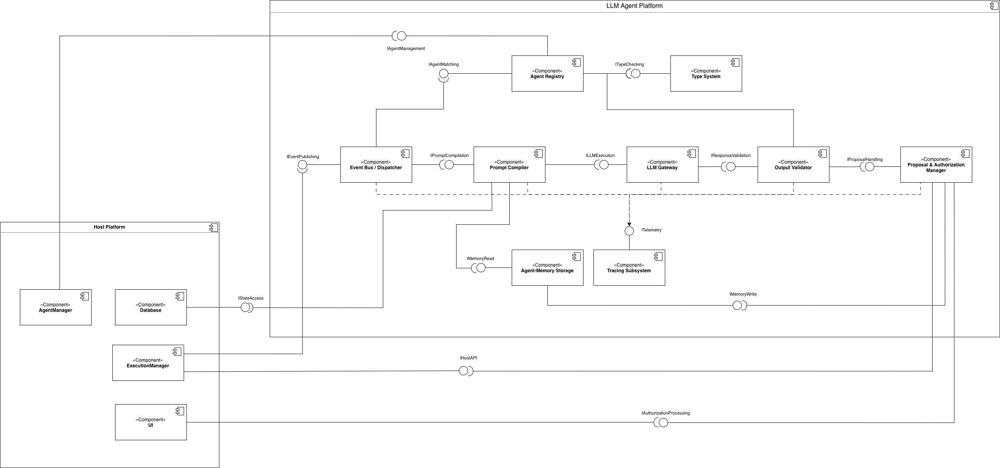
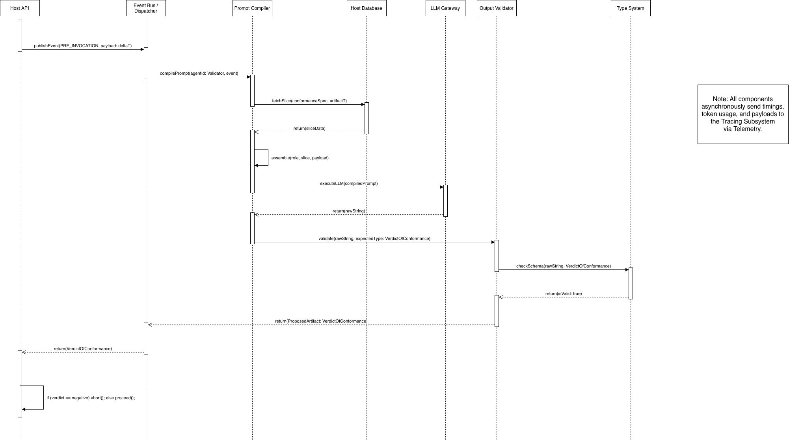
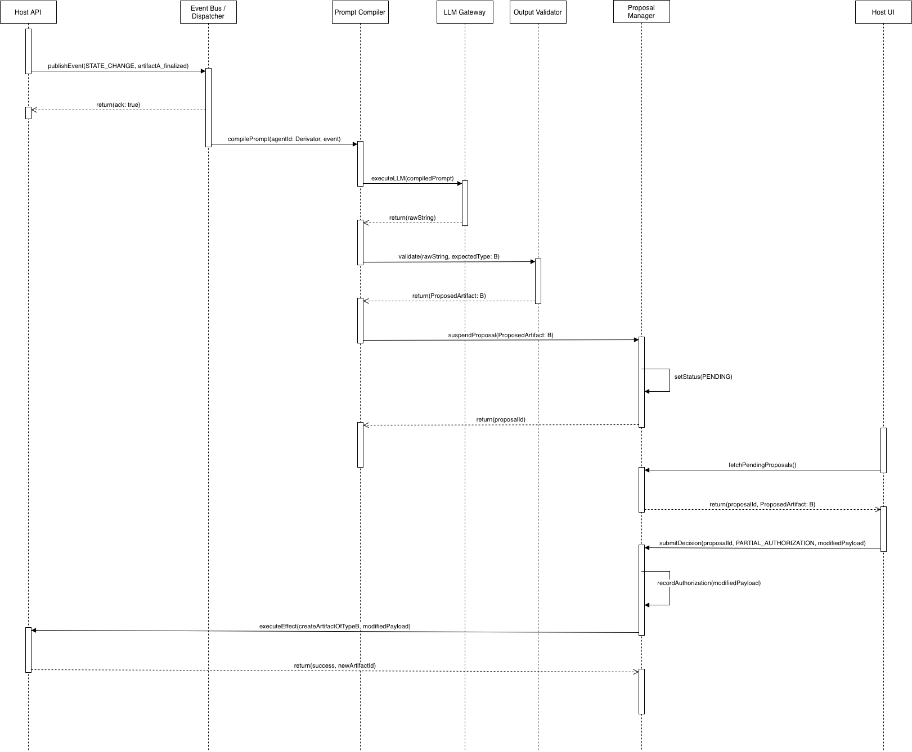
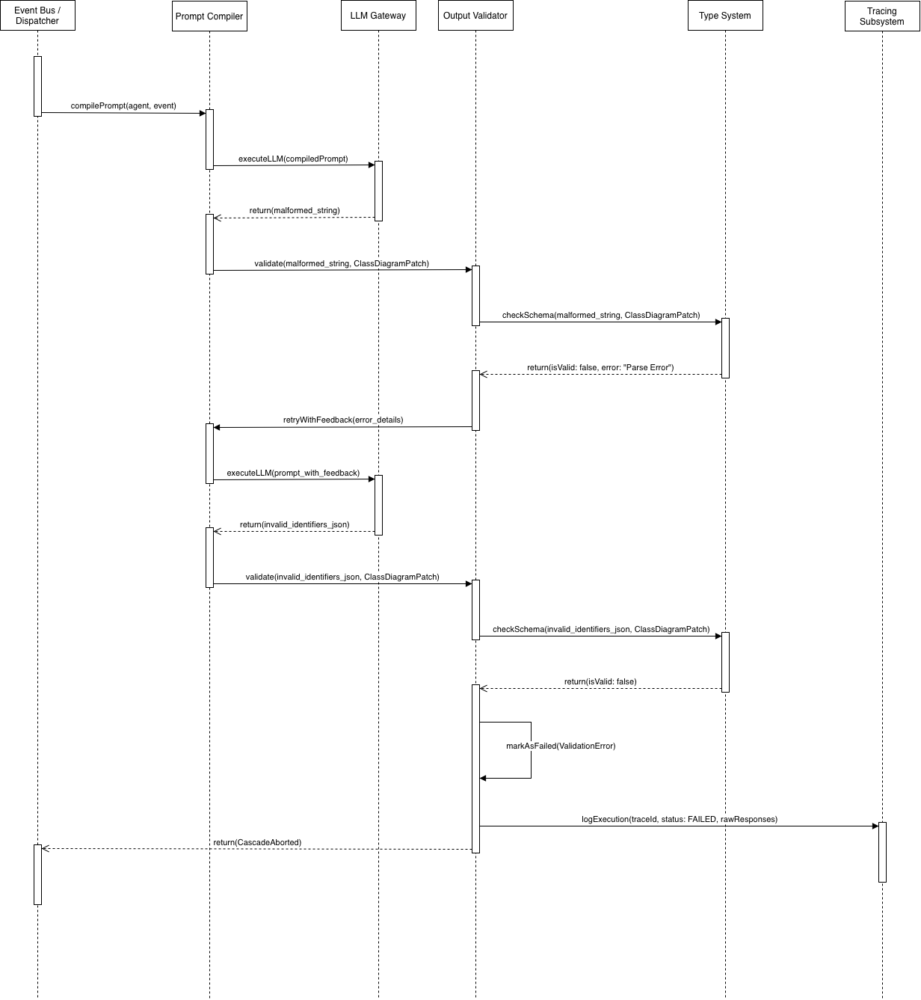

<!-- Improved compatibility of back to top link: See: https://github.com/othneildrew/Best-README-Template/pull/73 -->
<a id="readme-top"></a>

<!-- PROJECT SHIELDS -->
[![Contributors][contributors-shield]][contributors-url]
[![Forks][forks-shield]][forks-url]
[![Stargazers][stars-shield]][stars-url]
[![Issues][issues-shield]][issues-url]
[![LinkedIn][linkedin-shield]][linkedin-url]

<br />
<div align="center">
  <h2 align="center">A Generic Platform for Event-Driven, LLM-Based Agents</h2>

  <p align="center">
    Architectural Design Specification &bull; Advanced Modelling Techniques
    <br />
    <strong>University of L'Aquila &bull; Master's Degree in Computer Science (Advanced Software Engineering)</strong>
    <br />
    <br />
    <a href="#about-the-project"><strong>Explore the specification »</strong></a>
    <br />
    <br />
    <a href="requirements-v2.pdf">Course Requirements (PDF)</a>
    &middot;
    <a href="#architectural-component-model-ra-1">Component Model</a>
    &middot;
    <a href="#architectural-data-model-ra-3">Data Model</a>
    &middot;
    <a href="#sequence-diagrams-ra-2">Sequence Scenarios</a>
  </p>
</div>

<!-- TABLE OF CONTENTS -->
<details>
  <summary>Table of Contents</summary>
  <ol>
    <li>
      <a href="#about-the-project">About The Project</a>
      <ul>
        <li><a href="#project-overview">Project Overview</a></li>
        <li><a href="#academic-context">Academic Context</a></li>
        <li><a href="#built-with">Built With</a></li>
      </ul>
    </li>
    <li>
      <a href="#architectural-specification">Architectural Specification</a>
      <ul>
        <li><a href="#architectural-component-model-ra-1">Architectural Component Model (RA-1)</a></li>
        <li><a href="#sequence-diagrams-ra-2">Sequence Diagrams (RA-2)</a></li>
        <li><a href="#architectural-data-model-ra-3">Architectural Data Model (RA-3)</a></li>
        <li><a href="#compiled-system-prompt-model-ra-4">Compiled System Prompt Model (RA-4)</a></li>
        <li><a href="#design-rationale-ra-5">Design Rationale (RA-5)</a></li>
        <li><a href="#explicit-discussion-of-scenarios">Explicit Discussion of Scenarios</a></li>
      </ul>
    </li>
    <li>
      <a href="#getting-started">Getting Started</a>
      <ul>
        <li><a href="#prerequisites">Prerequisites</a></li>
        <li><a href="#installation-and-viewing">Installation and Viewing</a></li>
      </ul>
    </li>
    <li><a href="#usage">Usage</a></li>
    <li><a href="#contributors">Contributors</a></li>
    <li><a href="#contact">Contact</a></li>
    <li><a href="#acknowledgments">Acknowledgments</a></li>
  </ol>
</details>

<!-- ABOUT THE PROJECT -->
## About The Project

[![Product Name Screen Shot][product-screenshot]](diagrams/component_diagram/component_diagram.png)

### Project Overview

This repository hosts the comprehensive **Architectural Design Specification** for a generic, domain-independent platform enabling the definition and execution of Large Language Model (LLM)-based agents layered over a software platform. The reference host platform is modeled as an **internal API** (operations modifying state) combined with a **typed artifact store**.

Rather than implementing imperative hardcoded logic, agent behavior emerges dynamically from an LLM configured through a strictly compiled system prompt assembled from:
1. **Role Context**: Static instructions and behavioural constraints from the agent's specification.
2. **Authorized Context Slice**: Bounded read-only runtime state retrieved through declarative queries.
3. **Triggering Payload**: Enriched delta and metadata of the activating event.
4. **Longitudinal Memory**: Historical execution traces governed by strict retention policies (`STATELESS`, `WINDOW`, `SUMMARIZING`).

The architecture enforces a strict boundary between an agent's **proposed action** and its **actual effect** on the platform, requiring human authorization for state mutations to neutralize LLM hallucination and ensure non-deterministic operations never corrupt platform state.

### Academic Context

This project was developed as the course examination project for **Advanced Modelling Techniques** within the **Master's Degree in Computer Science (Advanced Software Engineering)** at the **University of L'Aquila (UNIVAQ)**.

* **Author:** Calogero Carlino
* **Student ID:** 302154
* **Institution:** University of L'Aquila (DISIM)
* **Academic Email:** [calogero.carlino@student.univaq.it](mailto:calogero.carlino@student.univaq.it)
* **Specifications Reference:** Course Project Requirements v2.0 (see [requirements-v2.pdf](requirements-v2.pdf))

<p align="right">(<a href="#readme-top">back to top</a>)</p>

### Built With

* [![Draw.io][drawio-shield]][drawio-url]
* [![UML 2.5][uml-shield]][uml-url]
* [![JSON Schema][json-shield]][json-url]
* [![Markdown][markdown-shield]][markdown-url]

<p align="right">(<a href="#readme-top">back to top</a>)</p>

<!-- ARCHITECTURAL SPECIFICATION -->
## Architectural Specification

### Architectural Component Model (RA-1)



The architecture of the LLM Agent Platform is structured as a highly cohesive, loosely coupled subsystem layered on top of an existing host environment. To satisfy the non-functional requirements of LLM-provider independence and structural predictability, all internal and external communication occurs strictly through explicitly defined interfaces.

The system acts as a unidirectional execution pipeline: events flow in from the host, are compiled into deterministic prompts, processed by the LLM, strictly validated against platform types, and finally suspended pending human authorization.

#### 1. The Execution Pipeline Components
These components handle the active lifecycle of an event transitioning into an authorized system effect.

* **Event Bus / Dispatcher**:
  The entry point of the agent subsystem. It listens for operational and stateful events from the host platform and initiates the cascade.  
  * **Exposes**: `IEventPublishing` (Receives incoming event payloads from the Host Platform).
  * **Requires**: `IAgentMatching` (Queries the Registry to determine which agents react to the event) and `IPromptCompilation` (Passes the matched event to the compiler).

* **Prompt Compiler**:
  The deterministic engine of the platform. It merges the agent's static specification with dynamic runtime data into the canonical JSON prompt format.  
  * **Exposes**: `IPromptCompilation` (Receives the triggering event and agent ID, returning the compiled JSON string).
  * **Requires**: `IStateAccess` (Fetches the strictly bounded context slice from the Host Database), `IMemoryRead` (Fetches longitudinal historical context), and `ILLMExecution` (Passes the compiled string to the Gateway).

* **LLM Gateway**:
  An abstraction layer that isolates the specific Large Language Model provider from the core architecture, satisfying the genericity and provider-independence requirements.
  * **Exposes**: `ILLMExecution` (Accepts the compiled JSON prompt and executes the external AI call).
  * **Requires**: `IResponseValidation` (Passes the raw, non-deterministic string output downstream).

* **Output Validator**:
  The strict gatekeeper that ensures the LLM's non-deterministic output conforms to the system's structural expectations.  
  * **Exposes**: `IResponseValidation` (Receives the raw LLM string, attempts to parse it into a polymorphic `ProposedAction`, and handles non-conforming recovery strategies).
  * **Requires**: `ITypeChecking` (Validates the parsed JSON against the expected schema) and `IProposalHandling` (Forwards successfully validated proposals).

* **Proposal & Authorization Manager**:
  The state machine that handles the critical human-in-the-loop requirement, suspending proposed writes until they are approved by a user.  
  * **Exposes**: `IProposalHandling` (Receives validated proposals from the Validator) and `IAuthorizationProcessing` (Receives human decisions from the Host UI).
  * **Requires**: `IHostAPI` (Executes authorized effects back onto the host platform) and `IMemoryWrite` (Records the final outcome to the agent's history).

#### 2. Foundation and Observability Services
These components sit outside the main pipeline, providing critical infrastructure, state management, and traceability.

* **Agent Registry**:
  The central repository for all static agent specifications. It manages the lifecycle and deterministic matching logic of the agents.  
  * **Exposes**: `IAgentManagement` (Allows dynamic registration/deregistration without restarting the platform) and `IAgentMatching` (Evaluates a given event against registered `TriggerConditions`).
  * **Requires**: `ITypeChecking` (Ensures declared input/output types are valid at the time of registration).

* **Type System**:
  The definitive source of truth for all structural descriptors in the platform, ensuring single and coherent typing across events, artifacts, and LLM outputs.
  * **Exposes**: `ITypeChecking` (Validates arbitrary data payloads against defined schemas).

* **Agent-Memory Storage**:
  The longitudinal database that implements the defined memory policies (`Stateless`, `Window`, `Summarizing`).  
  * **Exposes**: `IMemoryRead` (Provides historical data to the Prompt Compiler) and `IMemoryWrite` (Updates the record after a successful invocation).

* **Tracing Subsystem**:
  The observability hub. It acts as a decoupled "flight recorder" to reconstruct the entire causal cascade of events, LLM prompts, and user authorizations.  
  * **Exposes**: `ITelemetry` (A globally accessible interface used by all pipeline components to asynchronously log inputs, raw outputs, timings, and token consumption).

#### 3. The Host Platform Boundary
To explicitly define the domain limits, the architecture identifies the external host system (the "Generic Platform"). The LLM Agent framework integrates seamlessly by exposing endpoints for the Host to call, and consuming endpoints the Host provides.

* **AgentManager (Host)**: Consumes `IAgentManagement` to register new agents via external admin tooling.
* **Database (Host)**: Exposes `IStateAccess` so the Prompt Compiler can read typed artifacts.
* **ExecutionManager (Host)**: Consumes `IEventPublishing` to notify the Agent platform of system changes, and exposes `IHostAPI` so the Agent platform can apply authorized state effects.
* **UI (Host)**: Consumes `IAuthorizationProcessing` to submit human-in-the-loop decisions on pending proposals.

<p align="right">(<a href="#readme-top">back to top</a>)</p>

---

### Sequence Diagrams (RA-2)

#### Scenario 1: Synchronous Pre-Operation Validation

**Context**: A "Validator" agent, acting as an "expert in model conformance," is triggered before an API operation modifies an artifact of type `T`. Its output type is a `VerdictOfConformance`. If the verdict is negative, the operation is blocked.

**Architectural Justification**: This scenario demonstrates a strictly synchronous execution flow. Furthermore, because the agent's output is purely a read-based evaluation (a verdict) rather than a proposed state mutation (a write), the architecture explicitly bypasses the Proposal & Authorization Manager, requiring no human-in-the-loop.  



##### 1. Participating Lifelines
The following components are actively engaged in this specific cascade:
* `Host API`: The external platform initiating the modification. It physically blocks its execution thread while waiting for the subsystem's verdict.
* `Event Bus / Dispatcher`: The entry point that intercepts the operation and routes it.
* `Prompt Compiler`: The engine responsible for fetching data and deterministically building the agent's context.
* `Host Database`: Queried to resolve the agent's strictly bounded state slice.
* `LLM Gateway`: The external AI provider executing the prompt.
* `Output Validator`: Ensures the returned string strictly matches the required structural output type.
* `Type System`: Provides the schema validation rules.

##### 2. Chronological Execution Flow (Call & Return Details)
1. `publishEvent(PRE_INVOCATION, payload: deltaT)`: `Host API` &rarr; `Event Bus`. The host system announces an impending state change to an artifact of type `T`. Because this is a `PRE_INVOCATION` event, the `Host API` lifeline remains active (blocked) awaiting a response.
2. `compilePrompt(agentId: Validator, event)`: `Event Bus` &rarr; `Prompt Compiler`. The dispatcher matches the event to the Validator agent and passes the payload to the compiler.
3. `fetchSlice(conformanceSpec, artifactT)`: `Prompt Compiler` &rarr; `Host Database`. The compiler executes the agent's `ContextQuery` to retrieve only the authorized state slice: the current conformance guidelines and the pre-modification artifact.
4. `return(sliceData)`: `Host Database` &#x21e2; `Prompt Compiler`. The database returns the requested JSON data.
5. `assemble(role, slice, payload)`: `Prompt Compiler` &rarr; `Prompt Compiler` (Self-Call). The compiler deterministically merges the static role context, the fetched slice, and the triggering payload into the canonical JSON prompt format.
6. `executeLLM(compiledPrompt)`: `Prompt Compiler` &rarr; `LLM Gateway`. The formatted JSON string is transmitted to the external model.
7. `return(rawString)`: `LLM Gateway` &#x21e2; `Prompt Compiler`. The LLM returns a non-deterministic, raw text response.
8. `validate(rawString, expectedType: VerdictOfConformance)`: `Prompt Compiler` &rarr; `Output Validator`. The compiler hands the raw string downstream to be structurally verified.
9. `checkSchema(rawString, VerdictOfConformance)`: `Output Validator` &rarr; `Type System`. The validator queries the Type System to ensure the LLM's output conforms exactly to the registered descriptor.
10. `return(isValid: true)`: `Type System` &#x21e2; `Output Validator`. The type check passes.
11. `return(ProposedArtifact: VerdictOfConformance)`: `Output Validator` &#x21e2; `Event Bus`. Crucial architectural routing: because this is a `VerdictOfConformance` and not a state mutation proposal, the Validator skips the Proposal Manager and returns the structured artifact directly back up the chain to the dispatcher.
12. `return(VerdictOfConformance)`: `Event Bus` &#x21e2; `Host API`. The dispatcher unblocks the Host API by returning the final, typed verdict.
13. `if (verdict == negative) abort(); else proceed();`: `Host API` &rarr; `Host API` (Self-Call). The host system evaluates the Boolean inside the verdict. If it is negative, the original state modification is aborted.

##### 3. Observability Note
While not explicitly drawn as synchronous lifelines to preserve diagram readability, all components asynchronously push their inputs, outputs, timings, and token consumption to the Tracing Subsystem via the `ITelemetry` interface, ensuring total reconstruction of this cascade.

---

#### Scenario 2: Asynchronous Derivation with Authorization

**Context**: A "Derivator" agent is triggered when an artifact of type A transitions to a finalized state. Based on its context slice, its LLM response proposes the creation of a new artifact of type B. Because this proposal involves a state mutation (a write operation), it cannot be auto-applied and must be submitted to the user for authorization.  

**Architectural Justification**: This scenario demonstrates the system's asynchronous execution capabilities and the fundamental human-in-the-loop gatekeeping mechanism. By separating the agent's proposal from the system's actual effect, the architecture guarantees that LLM non-determinism cannot unilaterally corrupt the platform's state.



##### 1. Participating Lifelines
* `Host API`: Emits the initial event and eventually executes the authorized write.
* `Event Bus / Dispatcher`: Acknowledges the event asynchronously.
* `Prompt Compiler`: Assembles the context.
* `LLM Gateway`: Generates the non-deterministic proposal.
* `Output Validator`: Structurally validates the proposal against type `B`.
* `Proposal & Authorization Manager`: Suspends the proposal and waits for human input.
* `Host UI`: The frontend interface where the human user inspects and modifies the proposal.

##### 2. Chronological Execution Flow
1. `publishEvent(STATE_CHANGE, payload: artifactA_finalized)`: `Host API` &rarr; `Event Bus`. Host announces finalization of artifact A.
2. `return(ack: true)`: `Event Bus` &#x21e2; `Host API`. The Event Bus immediately returns an acknowledgment. This closes the Host API's activation box, proving the cascade is completely asynchronous and non-blocking.
3. `compilePrompt(agentId: Derivator, event)`: `Event Bus` &rarr; `Prompt Compiler`. Dispatcher routes the event.
4. `executeLLM(compiledPrompt)`: `Prompt Compiler` &rarr; `LLM Gateway`. The deterministic prompt is sent to the AI.
5. `return(rawString)`: `LLM Gateway` &#x21e2; `Prompt Compiler`. The AI returns its generation.
6. `validate(rawString, expectedType: B)`: `Prompt Compiler` &rarr; `Output Validator`. The string is checked against `Type System` schemas.
7. `return(ProposedArtifact: B)`: `Output Validator` &#x21e2; `Prompt Compiler`. The validation succeeds.
8. `suspendProposal(ProposedArtifact: B)`: `Prompt Compiler` &rarr; `Proposal & Authorization Manager`. Because this is a Write proposal, the compiler routes it to the Manager rather than back to the Event Bus.
9. `setStatus(PENDING)`: `Proposal Manager` &rarr; `Proposal Manager` (Self-Call). The proposal is saved as a first-class, inspectable entity with an expiration policy. The automated cascade suspends here.
10. `fetchPendingProposals()`: `Host UI` &rarr; `Proposal Manager`. Later, a human user logs in and queries their dashboard.
11. `return(proposalId, ProposedArtifact: B)`: `Proposal Manager` &#x21e2; `Host UI`. The manager serves the pending proposal for inspection.
12. `submitDecision(proposalId, PARTIAL_AUTHORIZATION, modifiedPayload)`: `Host UI` &rarr; `Proposal Manager`. The user tweaks the LLM's suggested artifact data and approves the modified version.
13. `recordAuthorization(modifiedPayload)`: `Proposal Manager` &rarr; `Proposal Manager` (Self-Call). The authorization entity is created, explicitly tracing human modifications.
14. `executeEffect(createArtifactOfTypeB, modifiedPayload)`: `Proposal Manager` &rarr; `Host API`. The manager forwards the approved payload to the host platform to execute the write.
15. `return(success, newArtifactId)`: `Host API` &#x21e2; `Proposal Manager`. Host confirms state mutation, finalizing the proposal lifecycle.

---

#### Scenario 3: Cascade with Intermediate Authorization

**Context**: This scenario extends Scenario 2. After the user authorizes the "Derivator" agent's proposal, the system creates Artifact B. The actual appearance of Artifact B in the store triggers a second agent, the "Indexer". The Indexer evaluates the new artifact and proposes an update to an existing Artifact C.  

**Architectural Justification**: This flow proves the system's ability to handle safely suspended cascades. The architecture explicitly prevents the Indexer from activating before the human authorizes Artifact B. If the user had rejected the Derivator's proposal, no effect would have been produced, no event would have fired, and the downstream cascade would have correctly been abandoned without leaving the system in an inconsistent state.


##### 1. Participating Lifelines
* `Host UI`: The human interface approving the first proposal.
* `Proposal & Authorization Manager`: Applies the approved effect and receives the new proposal.
* `Host API`: Executes the effect and emits the subsequent cascade event.
* `Event Bus / Dispatcher`: Catches the new event and matches the downstream agent.
* `Prompt Compiler`: Assembles the context.
* `LLM Gateway`: Generates the non-deterministic proposal.
* `Output Validator`: Structurally validates the proposal against type `C`.

##### 2. Chronological Execution Flow
1. `submitDecision(proposal_B, TOTAL_AUTHORIZATION)`: `Host UI` &rarr; `Proposal Manager`. User approves creation of Artifact `B`.
2. `executeEffect(createArtifactB)`: `Proposal Manager` &rarr; `Host API`. Manager instructs host to apply the approved write.
3. `commitTransaction(Artifact B)`: `Host API` &rarr; `Host API` (Self-Call). Host database physically saves the new artifact.
4. `publishEvent(STATE_CHANGE, new_artifact_B)`: `Host API` &rarr; `Event Bus`. The Cascade Trigger. Emits a new event, resuming the causal chain.
5. `compilePrompt(agentId: Indexer, event)`: `Event Bus` &rarr; `Prompt Compiler`. Dispatcher matches "Indexer" agent to this event.
6. `executeLLM(compiledPrompt)`: `Prompt Compiler` &rarr; `LLM Gateway`. Indexer's context is sent to AI.
7. `return(rawString)`: `LLM Gateway` &#x21e2; `Prompt Compiler`. AI generates proposed update for Artifact `C`.
8. `validate(rawString, expectedType: UpdateOperation_C)`: `Prompt Compiler` &rarr; `Output Validator`. Checked for valid update patch schema.
9. `return(ProposedWrite: Update C)`: `Output Validator` &#x21e2; `Prompt Compiler`. Validation passes.
10. `suspendProposal(ProposedWrite: Update C)`: `Prompt Compiler` &rarr; `Proposal Manager`. Forwarded to manager as a write proposal.
11. `setStatus(PENDING)`: `Proposal Manager` &rarr; `Proposal Manager` (Self-Call). Second proposal suspended awaiting user authorization.

---

#### Scenario 4: Non-Conforming LLM Response

**Context**: An agent declares its output type as `ClassDiagramPatch`. During an invocation, the LLM returns a response that fails validation—it might be free text, malformed JSON, or structurally valid JSON containing non-existent identifiers.

**Architectural Justification**: This scenario highlights the crucial boundary between non-deterministic AI generation and strictly typed system state. By intercepting the malformed response at the Output Validator, the architecture prevents platform corruption. Architecturally, an LLM validation failure is handled as a distinct, recoverable data-flow event rather than a fatal system crash.



##### 1. Participating Lifelines
* `Event Bus / Dispatcher`: Initiates workflow and receives the final abort signal if recovery fails.
* `Prompt Compiler`: Assembles context and handles retry prompts.
* `LLM Gateway`: The external AI generating the response.
* `Output Validator`: Primary actor detecting anomaly and executing recovery strategy.
* `Type System`: Evaluates schema conformance.
* `Tracing Subsystem`: Decoupled logger recording failures for observability.

##### 2. Chronological Execution Flow
1. `executeLLM(compiledPrompt)`: `Prompt Compiler` &rarr; `LLM Gateway`. Prompt sent to AI.
2. `return(malformed_string)`: `LLM Gateway` &#x21e2; `Prompt Compiler`. AI hallucinates free text instead of JSON.
3. `validate(malformed_string, ClassDiagramPatch)`: `Prompt Compiler` &rarr; `Output Validator`. String passed downstream.
4. `checkSchema(malformed_string, ClassDiagramPatch)`: `Output Validator` &rarr; `Type System`. Verification attempted.
5. `return(isValid: false, error: "Parse Error")`: `Type System` &#x21e2; `Output Validator`. Payload strictly rejected.
6. `retryWithFeedback(error_details)`: `Output Validator` &rarr; `Prompt Compiler`. **Recovery Strategy 1**: Re-prompting compiler with exact schema error appended as feedback.
7. `executeLLM(prompt_with_feedback)`: `Prompt Compiler` &rarr; `LLM Gateway`. Second attempt made.
8. `return(invalid_identifiers_json)`: `LLM Gateway` &#x21e2; `Prompt Compiler`. Valid JSON returned, but referencing non-existent identifiers.
9. `validate(invalid_identifiers_json, ClassDiagramPatch)` &rarr; `checkSchema(invalid_identifiers_json, ClassDiagramPatch)` &rarr; `return(isValid: false)`: Second validation fails semantic check.
10. `markAsFailed(ValidationError)`: `Output Validator` &rarr; `Output Validator` (Self-Call). **Recovery Strategy 2**: Budget exhausted / retry limit reached; cascade formally aborted.
11. `logExecution(traceId, status: FAILED, rawResponses)`: `Output Validator` &rarr; `Tracing Subsystem`. Distinct failure logged.
12. `return(CascadeAborted)`: `Output Validator` &#x21e2; `Event Bus`. Dispatcher notified to release pending resources.

<p align="right">(<a href="#readme-top">back to top</a>)</p>

---

### Architectural Data Model (RA-3)


The proposed data model provides a strongly typed, structurally predictable foundation for the event-driven, LLM-based agent platform. It explicitly separates static agent definitions from dynamic runtime execution and enforces a strict boundary between an agent’s proposed actions and their actual effects on the system state. The model is designed to guarantee total observability of the cascade chain.

#### 1. Core Lifecycle Entities (The Cascade)
These classes form the unbroken causal chain required to reconstruct the entire cascade of activations, proposals, authorizations, and effects.

* **Event**:
  An observable occurrence in the system acting as the catalyst for agent activation.
  * `id`: Unique identifier for the event.
  * `type`: Specific category of event (`EventType`).
  * `timestamp`: Precise ordering and isolation timestamp.
  * `sourceReference`: URI pointing to specific operation or artifact generating the event.
  * `originatingActor`: Identifies entity causing the event (`ActorType`).
  * `payload`: A `TypedArtifactDelta` capturing pre- and post-states.

* **Execution Trace**:
  A comprehensive audit log guaranteeing observability and traceability for every agent execution.
  * `traceId`: Unique identifier for the execution record.
  * `triggeringEventId`: Specific event initiating execution.
  * `compiledSystemPrompt`: Deterministic text sent to LLM, combined from context layers.
  * `inputPayload`: Raw JSON data provided to agent.
  * `rawLlmResponse`: Unedited textual output from LLM.
  * `validatedProposalId`: Links to resulting proposal if output conforms to required type.
  * `timings`: An `ExecutionMetrics` object tracking duration and resource consumption.

* **Proposal**:
  Suspended intent of the agent captured before any state mutation occurs. Agents cannot execute writes directly; they can only propose them.
  * `proposalId`: Unique identifier for the proposal.
  * `agentId`: Agent that generated the proposal.
  * `proposedAction`: Polymorphic `ProposedAction` detailing proposed action (artifact creation or API call).
  * `status`: Current state (`ProposalStatus`) pending human intervention.
  * `expirationPolicy`: Timestamp dictating when pending proposal times out.

* **Authorization**:
  The strict human-in-the-loop gatekeeping record. Every write proposal must pass through this entity.
  * `authId`: Unique identifier for authorization event.
  * `proposalId`: Specific proposal evaluated.
  * `userId`: Human user making the decision.
  * `decision`: Chosen outcome (`DecisionType`).
  * `modifiedState`: A `TypedArtifact` representing data if the user explicitly modified the proposal before approving it.

* **Effect**:
  Concrete manifestation of an approved proposal. Rejected writes produce no effects.
  * `effectId`: Unique identifier for applied mutation.
  * `authorizationId`: Explicit user approval permitting this effect.
  * `appliedMutations`: List of `StateChange` objects detailing systemic updates.
  * `resultingEvents`: List of new `EventID`s generated, capable of triggering subsequent agents in a cascade.

#### 2. Agent Definition and Context
* **Agent Specification**:
  The static, declarative blueprint of the agent. Behavior emerges from this specification rather than imperative code.
  * `id`: Unique identifier for the agent.
  * `trigger`: A `TriggerCondition` dictating when agent activates.
  * `inputType`: A `TypeDefinition` outlining expected incoming data.
  * `outputType`: A `TypeDefinition` restricting LLM's valid responses.
  * `systemPromptTemplate`: Textual material defining core role and constraints.
  * `authorizedContextSlice`: A `ContextQuery` defining strictly bounded data slice the agent is allowed to see.
  * `writeWhitelist`: Strict list of allowable API operations agent may propose.
  * `memoryPolicy`: Defined historical retention strategy (`MemoryPolicy`).

* **Memory**:
  A persistent, longitudinal record of the agent's prior invocations.
  * `agentId`: Agent this memory belongs to.
  * `policyType`: Rules governing memory behavior (`MemoryPolicy`).
  * `content`: A `TypedArtifact` holding inspectable historical data.

#### 3. The Polymorphic Proposal Action
Because an agent can output either a newly generated artifact or a request to invoke an internal API, a polymorphic structure maintains strict typing:

* **ProposedAction («abstract»)**:
  Base type serving as structural parent to guarantee `Proposal` remains strongly typed.
* **ProposedArtifact («concrete»)**:
  Used when agent proposes creating a new entry in the artifact store (`targetType`: `TypeDefinition`, `artifactData`: JSON).
* **ProposedWriteOperation («concrete»)**:
  Used when agent requests an API invocation to mutate existing state (`operationId`: string, `parameters`: JSON).

#### 4. Value Objects
* **TriggerCondition**: Declarative activation rules (`eventType`, `sourceType`, `payloadConditions`).
* **ContextQuery**: Bounded state access rules (`targetTypes`, `filterExpression`).
* **ExecutionMetrics**: Resource budgeting tracking (`startTime`, `endTime`, `tokenBudgetConsumed`).
* **TypedArtifactDelta**: State mutation observability (`previousState`, `newState`).
* **StateChange**: Atomic state modifications (`targetArtifactId`, `mutationType`, `mutationData`).

#### 5. Enumerations and System Boundaries

| Enumeration | Allowed Values | Architectural Justification (Why?) |
| :--- | :--- | :--- |
| **MemoryPolicy** | `STATELESS`, `WINDOW`, `SUMMARIZING` | Handles longitudinal context. `STATELESS` avoids bloat; `WINDOW` caps last *N* invocations; `SUMMARIZING` compresses history via LLM to respect token limits. |
| **EventType** | `PRE_INVOCATION`, `POST_INVOCATION`, `STATE_CHANGE` | Distinguishes operational (API) and data (artifact) events. `PRE_INVOCATION` allows synchronous blocking validation (Scenario 1). |
| **ActorType** | `USER`, `AGENT`, `SYSTEM` | Explicitly traces event origin, maintaining clear causal tracking between human actions and automated cascades. |
| **ProposalStatus** | `PENDING`, `AUTHORIZED`, `PARTIALLY_AUTHORIZED`, `REJECTED` | Models suspended write states. `PENDING` pauses cascades safely; `PARTIALLY_AUTHORIZED` allows humans to accept subsets of ideas. |
| **DecisionType** | `TOTAL_AUTHORIZATION`, `PARTIAL_AUTHORIZATION`, `TOTAL_REJECTION` | Enforces human-in-the-loop boundaries, separating agent suggestions from actual platform effects. |
| **MutationType** | `CREATE`, `UPDATE`, `DELETE` | Standardizes state store changes, enabling accurate delta tracking and downstream cascade triggering. |

#### 6. Foundation Platform Classes
* **TypeDefinition**: Structural descriptor for artifacts, inputs, or outputs. Serves as single source of truth for typing (`typeName`, `schemaDefinition`).
* **TypedArtifact**: Fundamental persistent store unit, identified by `id`, `type` (`TypeDefinition`), and `state` (`JSONObject` guaranteed to match schema).

<p align="right">(<a href="#readme-top">back to top</a>)</p>

---

### Compiled System Prompt Model (RA-4)

#### 1. The Canonical Format: Structured JSON Template
The architecture utilizes a Structured JSON Template as the canonical format for prompt compilation. Rather than relying on free-text concatenation (e.g., using XML tags or markdown delimiters like `###`, which are vulnerable to prompt injection), the platform compiles the agent’s context into a single, strictly typed JSON object.

This choice guarantees structural predictability (RNF-6). Modern LLMs are highly optimized for JSON parsing, and this format allows the platform to explicitly separate system instructions from dynamic, untrusted data.

#### 2. Explicit Quoting and Boundary Rules
To protect the role instructions from being overridden by malicious or malformed data in the payload or slice, the compiler enforces three boundary rules:
1. **Serialization**: All dynamically resolved data (Artifact states, User inputs) MUST be standard JSON-serialized before insertion into the template.
2. **Escaping**: All internal quotation marks within strings MUST be strictly escaped (`\"`). Newlines MUST be escaped as `\n`.
3. **Passive Data Enforcement**: The LLM is instructed in the root `system_directive` to treat the `slice`, `payload`, and `memory` layers strictly as passive data sources, not as executable instructions.

#### 3. The Prompt Schema
Every compiled prompt follows this exact hierarchical schema:

```json
{
  "system_directive": "You are an autonomous agent within a strictly typed platform. Read the context layers and produce a single JSON object conforming EXACTLY to the specified output_type. Do not output conversational text.",
  "output_type_schema": { 
     // Injected JSONSchema of the required Agent Output Type
  },
  "context_layers": {
    "role": {
       // Static instructions from the Agent Specification
    },
    "slice": {
       // Runtime-resolved read-only state
    },
    "payload": {
       // The triggering event delta and metadata
    },
    "memory": {
       // Historical invocations based on the Memory Policy
    }
  }
}
```

<p align="right">(<a href="#readme-top">back to top</a>)</p>

---

### Design Rationale (RA-5)

This section formally justifies core architectural decisions against discarded alternatives:

1. **Event Model: Decoupled Publish/Subscribe vs. Direct Invocation**
   * *Chosen*: Decoupled Event Bus where host publishes events unaware of listening agents.
   * *Discarded*: Point-to-point API invocation (`AgentManager.wakeUp(agentId)`).
   * *Justification*: Direct invocation couples host logic to agents. Decoupled pub/sub enables dynamic registration without host redeployment.

2. **Trigger Language: Declarative Conditions vs. Imperative Scripts**
   * *Chosen*: Declarative `TriggerCondition` objects evaluating boolean expressions on payloads.
   * *Discarded*: Imperative JavaScript scripts (`shouldWakeUp(event)`).
   * *Justification*: Imperative scripts risk infinite loops and memory leaks in dispatcher. Declarative conditions guarantee structural predictability and static analysis.

3. **Type System: Centralized Strict Schemas vs. Schema-less JSON**
   * *Chosen*: Centralized `Type System` enforcing strict polymorphic schemas (`TypeDefinition`).
   * *Discarded*: Dynamic schema-less JSON payloads.
   * *Justification*: Prevents database corruption from LLM hallucination and enables UI to generate dynamic authorization forms.

4. **Cascade Policy: Asynchronous Suspension vs. Synchronous Chaining**
   * *Chosen*: Cascades broken into asynchronous event-driven steps suspended awaiting human authorization.
   * *Discarded*: Synchronous in-memory chaining across agents.
   * *Justification*: Synchronous chaining violates human-in-the-loop safety for mutations and compounds transaction rollback risks.

5. **Prompt Format: Structured JSON vs. Free-Text / XML**
   * *Chosen*: Hierarchical JSON object separating `system_directive`, `output_type_schema`, and `context_layers`.
   * *Discarded*: Free-text string concatenation or XML markdown delimiters.
   * *Justification*: Prevents Prompt Injection vulnerabilities and exploits LLM optimization for structured JSON parsing.

6. **Non-Conforming Response Strategy: Data-Flow Recovery vs. System Exceptions**
   * *Chosen*: `Output Validator` handles malformed outputs through retry-with-feedback loops and graceful cascade abortion.
   * *Discarded*: Throwing fatal system exceptions crashing threads or returning HTTP 500s.
   * *Justification*: LLM non-determinism is an operational reality, not a software bug. Recoverable data-flow handling ensures host stability.

7. **Memory Policy: Configurable Bounding vs. Unbounded Context**
   * *Chosen*: Explicit policies (`STATELESS`, `WINDOW`, `SUMMARIZING`) bounding historical tokens.
   * *Discarded*: Appending infinite execution histories.
   * *Justification*: Unbounded context inevitably hits token limits and explodes operational costs.

8. **Authorization Model: Suspended Intent vs. Auto-Execution Rollbacks**
   * *Chosen*: Suspended intent (`ProposedAction`) requiring explicit approval before state writes occur.
   * *Discarded*: Auto-execution with rollback mechanisms.
   * *Justification*: Rollbacks cannot undo irreversible external effects (e.g. sent emails, external webhooks). Gatekeeping prevents corruption proactively.

<p align="right">(<a href="#readme-top">back to top</a>)</p>

---

### Explicit Discussion of Scenarios

*Note: Scenarios 1, 2, 3, and 4 are modeled in detail with sequence diagrams in the [Sequence Diagrams (RA-2)](#sequence-diagrams-ra-2) section.*

* **Scenario 1: Synchronous Pre-Operation Validation**:
  Validator agent executes synchronously upon `PRE_INVOCATION` events, returning a `VerdictOfConformance`. Safely bypasses the `Proposal Manager` because verdicts are read-only assertions.

* **Scenario 2: Asynchronous Derivation with Authorization**:
  Derivator agent responds asynchronously to `STATE_CHANGE` events. Proposes creating artifact B; proposal is suspended in `Proposal Manager` until user inspects, optionally modifies, and authorizes the mutation.

* **Scenario 3: Cascade with Intermediate Authorization**:
  User authorization of Artifact B triggers Host API write, which emits a new event activating the Indexer agent. Proves that cascades are safely partitioned across human authorization boundaries.

* **Scenario 4: Non-Conforming LLM Response**:
  Output Validator catches malformed responses, triggers retry-with-feedback with schema errors, and logs graceful `CascadeAborted` telemetry upon retry exhaustion without crashing the platform.

* **Scenario 5: Concurrency on the Same Event**:
  Three agents react to one event (one fails validation, one is rejected by user, one is an auto-applicable read). The `Event Bus` fans out into independent execution threads. Strict isolation ensures failures in thread 1 and rejections in thread 2 do not hinder thread 3.

* **Scenario 6: Potential Loop**:
  An agent continuously proposes mutations on the triggering artifact. Protected via two layers: (1) `ExecutionMetrics` cascading budget decrements, and (2) `Event Bus` cascade-depth tracking with UI `POTENTIAL_LOOP` warnings before user approval.

* **Scenario 7: Memory and Longitudinal Learning (Concrete Compilation Example)**:
  A Reviewer agent uses a `WINDOW(10)` FIFO memory policy to track violations. Below is the concrete compiled JSON template demonstrating how role, slice, payload, and historical memory layers are assembled:

```json
{
  "system_directive": "You are an autonomous agent within a strictly typed platform. Read the context layers and produce a single JSON object conforming EXACTLY to the specified output_type. Do not output conversational text.",
  "output_type_schema": {
    "type": "object",
    "properties": {
      "isApproved": { "type": "boolean" },
      "feedback": { "type": "string" },
      "notedSystematicViolations": { "type": "boolean" }
    },
    "required": ["isApproved", "feedback", "notedSystematicViolations"]
  },
  "context_layers": {
    "role": {
      "agent_id": "reviewer_agent_v1",
      "capabilities": "You are a code/contribution reviewer. Check the payload against the slice guidelines. Check memory to see if this actor repeats mistakes. If a mistake is repeated, set notedSystematicViolations to true and reject."
    },
    "slice": {
      "data": [
        {
          "type": "ContributionGuidelines",
          "id": "doc_992",
          "state": {
            "rule_1": "All variables must use camelCase.",
            "rule_2": "Contributions must include unit tests."
          }
        }
      ]
    },
    "payload": {
      "event_type": "PRE_INVOCATION",
      "originating_actor": "User_445",
      "operation": "submitContribution",
      "target_data": {
        "contribution_title": "Update login logic",
        "code_snippet": "let User_login_status = true;",
        "has_tests": false
      }
    },
    "memory": {
      "policy": "WINDOW",
      "retention_count": 10,
      "historical_invocations": [
        {
          "timestamp": "2026-04-18T10:00:00Z",
          "actor": "User_445",
          "previous_feedback": "Rejected: Missing unit tests. Please include them next time."
        },
        {
          "timestamp": "2026-04-19T14:30:00Z",
          "actor": "User_445",
          "previous_feedback": "Rejected: Variables must be camelCase, not snake_case."
        }
      ]
    }
  }
}
```

* **Scenario 8: Type Evolution**:
  When artifact schemas evolve, discrepancies are caught by the `Output Validator`. Outdated agent outputs omitting new mandatory fields fail validation, marking the agent as `DEPRECATED_SCHEMA` in the `Agent Registry` while safeguarding store integrity.

<p align="right">(<a href="#readme-top">back to top</a>)</p>

<!-- GETTING STARTED -->
## Getting Started

To explore and inspect the architectural designs and models locally, follow the steps below.

### Prerequisites

* **Diagram Inspection**:
  * Any standard image viewer or web browser for viewing `.png` diagrams.
  * [Draw.io / diagrams.net](https://app.diagrams.net/) (desktop or web app) or the VS Code [Draw.io Integration extension](https://marketplace.visualstudio.com/items?itemName=hediet.vscode-drawio) to edit or inspect source `.drawio` files.
* **Document Viewer**:
  * A standard PDF reader for [requirements-v2.pdf](requirements-v2.pdf).
* **Git**:
  * Standard git client installed.

### Installation and Viewing

1. Clone the repository:
   ```sh
   git clone https://github.com/CarlinoCalogero/univaq-advanced-modelling-techniques.git
   cd univaq-advanced-modelling-techniques
   ```

2. Open the diagram directory:
   * **Component Diagram (RA-1)**: [diagrams/component_diagram/component_diagram.drawio](diagrams/component_diagram/component_diagram.drawio)
   * **Class Diagram (RA-3)**: [diagrams/class_diagram/class_diagram.drawio](diagrams/class_diagram/class_diagram.drawio)
   * **Sequence Diagrams (RA-2)**:
     * Scenario 1: [diagrams/sequence_diagrams/sequence_diagram_scenario_1.drawio](diagrams/sequence_diagrams/sequence_diagram_scenario_1.drawio)
     * Scenario 2: [diagrams/sequence_diagrams/sequence_diagram_scenario_2.drawio](diagrams/sequence_diagrams/sequence_diagram_scenario_2.drawio)
     * Scenario 3: [diagrams/sequence_diagrams/sequence_diagram_scenario_3.drawio](diagrams/sequence_diagrams/sequence_diagram_scenario_3.drawio)
     * Scenario 4: [diagrams/sequence_diagrams/sequence_diagram_scenario_4.drawio](diagrams/sequence_diagrams/sequence_diagram_scenario_4.drawio)

<p align="right">(<a href="#readme-top">back to top</a>)</p>

<!-- USAGE EXAMPLES -->
## Usage

This repository serves as an architectural reference and evaluation artifact. It can be used to:
1. **Understand Event-Driven LLM Systems**: Learn how to bridge non-deterministic Large Language Models with strictly typed, deterministic software architectures.
2. **Implement Human-in-the-Loop Workflows**: Study the separation between agent proposals (`ProposedAction`) and executed platform effects (`Effect`).
3. **Design Structured Prompts**: Reference the canonical JSON prompt compilation model isolating role instructions from untrusted dynamic inputs.
4. **Evaluate System Scenarios**: Examine how edge cases (concurrency, infinite cascades, memory windowing, and type migrations) are handled systematically.

<p align="right">(<a href="#readme-top">back to top</a>)</p>

<!-- CONTRIBUTORS -->
## Contributors

> [!NOTE]
> This repository represents a completed university academic project for the Master's Degree in Computer Science at the University of L'Aquila. As such, it is preserved as an academic archive and does **not** accept external contributions or pull requests.

### Author & Contributors:

<a href="https://github.com/CarlinoCalogero/univaq-advanced-modelling-techniques/graphs/contributors">
  
</a>

* **Calogero Carlino** - *Architectural Design, Models & Documentation* - [@CarlinoCalogero](https://github.com/CarlinoCalogero)

<p align="right">(<a href="#readme-top">back to top</a>)</p>

<!-- CONTACT -->
## Contact

**Calogero Carlino**  
Master's Graduate in Computer Science (Advanced Software Engineering) &bull; Game Programmer  
University of L'Aquila  

* **Personal / Dev Email:** [carlinocalogero.dev@gmail.com](mailto:carlinocalogero.dev@gmail.com)
* **University Email:** [calogero.carlino@student.univaq.it](mailto:calogero.carlino@student.univaq.it)
* **LinkedIn:** [linkedin.com/in/calogero-carlino-2a94a33b5](https://www.linkedin.com/in/calogero-carlino-2a94a33b5/)
* **GitHub Profile:** [github.com/CarlinoCalogero](https://github.com/CarlinoCalogero)
* **Portfolio Website:** [carlinocalogero.github.io](https://carlinocalogero.github.io)
* **Project Repository:** [github.com/CarlinoCalogero/univaq-advanced-modelling-techniques](https://github.com/CarlinoCalogero/univaq-advanced-modelling-techniques)

<p align="right">(<a href="#readme-top">back to top</a>)</p>

<!-- ACKNOWLEDGMENTS -->
## Acknowledgments

* [University of L'Aquila (UNIVAQ)](https://www.univaq.it/) – Department of Information Engineering, Computer Science and Mathematics (DISIM)
* Advanced Modelling Techniques Course Examination Committee & Instructors
* [Best-README-Template](https://github.com/othneildrew/Best-README-Template) by [Othneil Drew](https://github.com/othneildrew)
* [Draw.io / diagrams.net](https://app.diagrams.net/)
* [Shields.io](https://shields.io)
* [Contrib.rocks](https://contrib.rocks)

<p align="right">(<a href="#readme-top">back to top</a>)</p>

<!-- MARKDOWN LINKS & IMAGES -->
<!-- https://www.markdownguide.org/basic-syntax/#reference-style-links -->
[contributors-shield]: https://img.shields.io/github/contributors/CarlinoCalogero/univaq-advanced-modelling-techniques.svg?style=for-the-badge&color=blue
[contributors-url]: https://github.com/CarlinoCalogero/univaq-advanced-modelling-techniques/graphs/contributors
[forks-shield]: https://img.shields.io/github/forks/CarlinoCalogero/univaq-advanced-modelling-techniques.svg?style=for-the-badge&color=blue
[forks-url]: https://github.com/CarlinoCalogero/univaq-advanced-modelling-techniques/network/members
[stars-shield]: https://img.shields.io/github/stars/CarlinoCalogero/univaq-advanced-modelling-techniques.svg?style=for-the-badge&color=blue
[stars-url]: https://github.com/CarlinoCalogero/univaq-advanced-modelling-techniques/stargazers
[issues-shield]: https://img.shields.io/github/issues/CarlinoCalogero/univaq-advanced-modelling-techniques.svg?style=for-the-badge
[issues-url]: https://github.com/CarlinoCalogero/univaq-advanced-modelling-techniques/issues
[linkedin-shield]: https://img.shields.io/badge/-LinkedIn-black.svg?style=for-the-badge&logo=linkedin&colorB=555
[linkedin-url]: https://www.linkedin.com/in/calogero-carlino-2a94a33b5/
[product-screenshot]: diagrams/component_diagram/component_diagram.png
[drawio-shield]: https://img.shields.io/badge/Draw.io-F08705?style=for-the-badge&logo=diagramsdotnet&logoColor=white
[drawio-url]: https://app.diagrams.net/
[uml-shield]: https://img.shields.io/badge/UML_2.5-00557f?style=for-the-badge&logo=uml&logoColor=white
[uml-url]: https://www.omg.org/spec/UML/
[json-shield]: https://img.shields.io/badge/JSON_Schema-000000?style=for-the-badge&logo=json&logoColor=white
[json-url]: https://json-schema.org/
[markdown-shield]: https://img.shields.io/badge/Markdown-000000?style=for-the-badge&logo=markdown&logoColor=white
[markdown-url]: https://daringfireball.net/projects/markdown/
