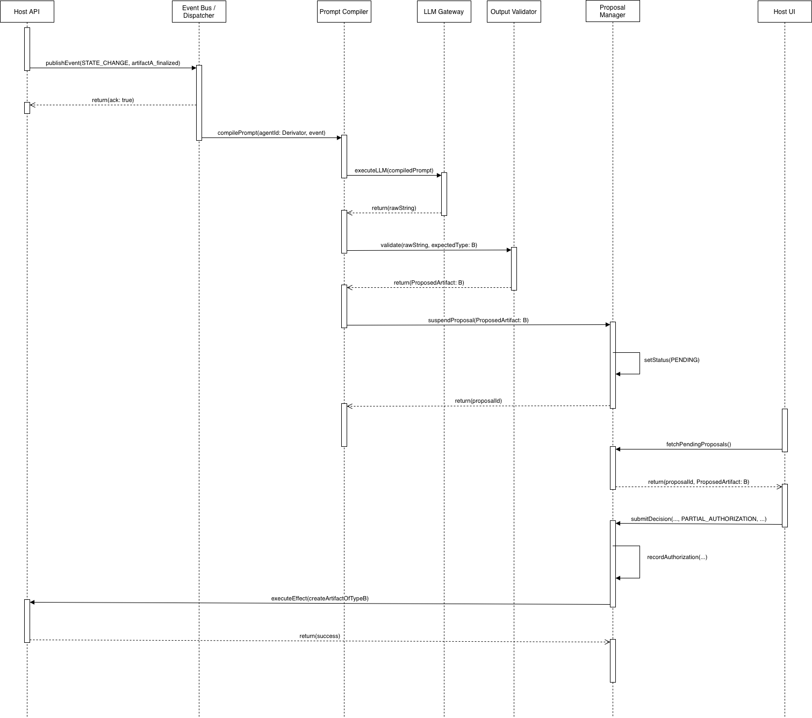
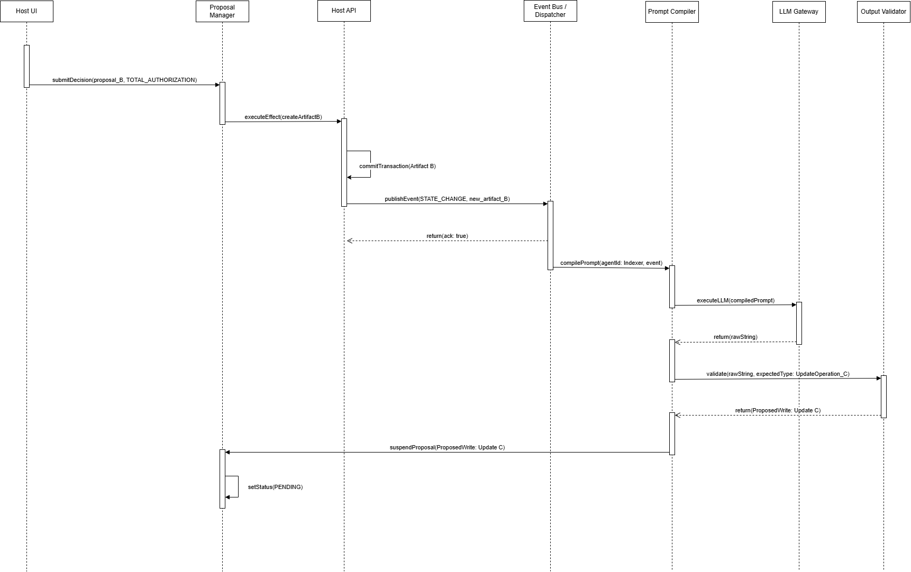
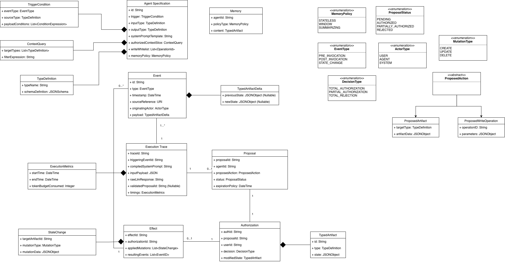

## Architectural Component Model (RA-1)


The architecture of the LLM Agent Platform is structured as a highly cohesive, loosely coupled subsystem layered on top of an existing host environment. To satisfy the non-functional requirements of LLM-provider independence and structural predictability, all internal and external communication occurs strictly through explicitly defined interfaces.

The system acts as a unidirectional execution pipeline: events flow in from the host, are compiled into deterministic prompts, processed by the LLM, strictly validated against platform types, and finally suspended pending human authorization.

### 1. The Execution Pipeline Components
These components handle the active lifecycle of an event transitioning into an authorized system effect.

#### Event Bus / Dispatcher
The entry point of the agent subsystem. It listens for operational and stateful events from the host platform and initiates the cascade.  

* **Exposes**: `IEventPublishing` (Receives incoming event payloads from the Host Platform).
* **Requires**: `IAgentMatching` (Queries the Registry to determine which agents react to the event) and `IPromptCompilation` (Passes the matched event to the compiler).

#### Prompt Compiler
The deterministic engine of the platform. It merges the agent's static specification with dynamic runtime data into the canonical JSON prompt format.  

* **Exposes**: `IPromptCompilation` (Receives the triggering event and agent ID, returning the compiled JSON string).
* **Requires**: `IStateAccess` (Fetches the strictly bounded context slice from the Host Database), `IMemoryRead` (Fetches longitudinal historical context), and `ILLMExecution` (Passes the compiled string to the Gateway).

#### LLM Gateway
An abstraction layer that isolates the specific Large Language Model provider from the core architecture, satisfying the genericity and provider-independence requirements.

* **Exposes**: `ILLMExecution` (Accepts the compiled JSON prompt and executes the external AI call).
* **Requires**: `IResponseValidation` (Passes the raw, non-deterministic string output downstream).

#### Output Validator
The strict gatekeeper that ensures the LLM's non-deterministic output conforms to the system's structural expectations.  

* **Exposes**: `IResponseValidation` (Receives the raw LLM string, attempts to parse it into a polymorphic `ProposedAction`, and handles non-conforming recovery strategies).
* **Requires**: `ITypeChecking` (Validates the parsed JSON against the expected schema) and `IProposalHandling` (Forwards successfully validated proposals).

#### Proposal & Authorization Manager
The state machine that handles the critical human-in-the-loop requirement, suspending proposed writes until they are approved by a user.  

* **Exposes**: `IProposalHandling` (Receives validated proposals from the Validator) and `IAuthorizationProcessing` (Receives human decisions from the Host UI).
* **Requires**: `IHostAPI` (Executes authorized effects back onto the host platform) and `IMemoryWrite` (Records the final outcome to the agent's history).

### 2. Foundation and Observability Services
These components sit outside the main pipeline, providing critical infrastructure, state management, and traceability.

#### Agent Registry
The central repository for all static agent specifications. It manages the lifecycle and deterministic matching logic of the agents.  

* `Exposes`: `IAgentManagement` (Allows dynamic registration/deregistration without restarting the platform) and `IAgentMatching` (Evaluates a given event against registered `TriggerConditions`).
* `Requires`: `ITypeChecking` (Ensures declared input/output types are valid at the time of registration).

#### Type System
The definitive source of truth for all structural descriptors in the platform, ensuring single and coherent typing across events, artifacts, and LLM outputs.

* **Exposes**: `ITypeChecking` (Validates arbitrary data payloads against defined schemas).

#### Agent-Memory Storage
The longitudinal database that implements the defined memory policies (Stateless, Window, Summarizing).  

* **Exposes**: `IMemoryRead` (Provides historical data to the Prompt Compiler) and `IMemoryWrite` (Updates the record after a successful invocation).

#### Tracing Subsystem
The observability hub. It acts as a decoupled "flight recorder" to reconstruct the entire causal cascade of events, LLM prompts, and user authorizations.  

* **Exposes**: `ITelemetry` (A globally accessible interface used by all pipeline components to asynchronously log inputs, raw outputs, timings, and token consumption).

### 3. The Host Platform Boundary
To explicitly define the domain limits, the architecture identifies the external host system (the "Generic Platform"). The LLM Agent framework integrates seamlessly by exposing endpoints for the Host to call, and consuming endpoints the Host provides.

* **AgentManager (Host)**: Consumes `IAgentManagement` to register new agents via external admin tooling.
* **Database (Host)**: Exposes `IStateAccess` so the Prompt Compiler can read typed artifacts.
* **ExecutionManager (Host)**: Consumes `IEventPublishing` to notify the Agent platform of system changes, and exposes `IHostAPI` so the Agent platform can apply authorized state effects.
* **UI (Host)**: Consumes `IAuthorizationProcessing` to submit human-in-the-loop decisions on pending proposals.

## Sequence Diagrams (RA-2)

### Scenario 1: Synchronous Pre-Operation Validation

**Context**: A "Validator" agent, acting as an "expert in model conformance," is triggered before an API operation modifies an artifact of type `T`. Its output type is a `VerdictOfConformance`. If the verdict is negative, the operation is blocked.

**Architectural Justification**: This scenario demonstrates a strictly synchronous execution flow. Furthermore, because the agent's output is purely a read-based evaluation (a verdict) rather than a proposed state mutation (a write), the architecture explicitly bypasses the Proposal & Authorization Manager, requiring no human-in-the-loop.  


#### 1. Participating Lifelines
The following components are actively engaged in this specific cascade:

* `Host API`: The external platform initiating the modification. It physically blocks its execution thread while waiting for the subsystem's verdict.
* `Event Bus / Dispatcher`: The entry point that intercepts the operation and routes it.
* `Prompt Compiler`: The engine responsible for fetching data and deterministically building the agent's context.
* `Host Database`: Queried to resolve the agent's strictly bounded state slice.
* `LLM Gateway`: The external AI provider executing the prompt.
* `Output Validator`: Ensures the returned string strictly matches the required structural output type.
* `Type System`: Provides the schema validation rules.

#### 2. Chronological Execution Flow (Call & Return Details)
The diagram traces the following exact sequence of operations:

1. `publishEvent(PRE_INVOCATION, payload: deltaT)`
    * `Host API` → `Event Bus`: The host system announces an impending state change to an artifact of type `T`. Because this is a `PRE_INVOCATION` event, the `Host API` lifeline remains active (blocked) awaiting a response.  
2. `compilePrompt(agentId: Validator, event)`
    * `Event Bus` → `Prompt Compiler`: The dispatcher matches the event to the Validator agent and passes the payload to the compiler.
3. `fetchSlice(conformanceSpec, artifactT)`
    * `Prompt Compiler` → `Host Database`: The compiler executes the agent's `ContextQuery` to retrieve only the authorized state slice: the current conformance guidelines and the pre-modification artifact.  
4. `return(sliceData)`
    * `Host Database` ⇢ `Prompt Compiler`: The database returns the requested JSON data.
5. `assemble(role, slice, payload)`
    * `Prompt Compiler` → `Prompt Compiler` (Self-Call): The compiler deterministically merges the static role context, the fetched slice, and the triggering payload into the canonical JSON prompt format.
6. `executeLLM(compiledPrompt)`
    * `Prompt Compiler` → `LLM Gateway`: The formatted JSON string is transmitted to the external model.
7. `return(rawString)`
    * `LLM Gateway` ⇢ `Prompt Compiler`: The LLM returns a non-deterministic, raw text response.
8. `validate(rawString, expectedType: VerdictOfConformance)`
    * `Prompt Compiler` → `Output Validator`: The compiler hands the raw string downstream to be structurally verified.  
9. `checkSchema(rawString, VerdictOfConformance)`
    * `Output Validator` → `Type System`: The validator queries the Type System to ensure the LLM's output conforms exactly to the registered descriptor.
10. `return(isValid: true)`
    * `Type System` ⇢ `Output Validator`: The type check passes.
11. `return(ProposedArtifact: VerdictOfConformance)`
    * `Output Validator` ⇢ `Event Bus`: Crucial architectural routing. Because this is a `VerdictOfConformance` and not a state mutation proposal, the Validator skips the Proposal Manager and returns the structured artifact directly back up the chain to the dispatcher.
12. `return(VerdictOfConformance)`
    * `Event Bus` ⇢ `Host API`: The dispatcher unblocks the Host API by returning the final, typed verdict.
13. `if (verdict == negative) abort(); else proceed();`
    * `Host API` → `Host API` (Self-Call): The host system evaluates the Boolean inside the verdict. If it is negative, the original state modification is aborted.  

#### 3. Observability Note
While not explicitly drawn as synchronous lifelines to preserve diagram readability, all components (Event Bus, Prompt Compiler, Gateway, and Validator) asynchronously push their inputs, outputs, timings, and token consumption to the Tracing Subsystem via the `ITelemetry` interface, ensuring total reconstruction of this cascade.

### Scenario 2: Asynchronous Derivation with Authorization
**Context**: A "Derivator" agent is triggered when an artifact of type A transitions to a finalized state. Based on its context slice, its LLM response proposes the creation of a new artifact of type B. Because this proposal involves a state mutation (a write operation), it cannot be auto-applied and must be submitted to the user for authorization.  

**Architectural Justification**: This scenario demonstrates the system's asynchronous execution capabilities and the fundamental human-in-the-loop gatekeeping mechanism. By separating the agent's proposal from the system's actual effect, the architecture guarantees that LLM non-determinism cannot unilaterally corrupt the platform's state.



#### 1. Participating Lifelines

* `Host API`: Emits the initial event and eventually executes the authorized write.
* `Event Bus / Dispatcher`: Acknowledges the event asynchronously.
* `Prompt Compiler`: Assembles the context.
* `LLM Gateway`: Generates the non-deterministic proposal.
* `Output Validator`: Structurally validates the proposal against type `B`.
* `Proposal & Authorization Manager`: Suspends the proposal and waits for human input.
* `Host UI`: The frontend interface where the human user inspects and modifies the proposal.

#### 2. Chronological Execution Flow

1. `publishEvent(STATE_CHANGE, payload: artifactA_finalized)`
    * `Host API` → `Event Bus`: The host system announces the finalization of artifact A.
2. `return(ack: true)`
    * `Event Bus` ⇢ `Host API`: The Event Bus immediately returns an acknowledgment. This closes the Host API's activation box, proving the subsequent cascade is completely asynchronous and non-blocking.
3. `compilePrompt(agentId: Derivator, event)`
    * `Event Bus` → `Prompt Compiler`: The dispatcher routes the event.
4. `executeLLM(compiledPrompt)`
    * `Prompt Compiler` → `LLM Gateway`: The deterministic prompt is sent to the AI.
5. `return(rawString)`
    * `LLM Gateway` ⇢ `Prompt Compiler`: The AI returns its generation.
6. `validate(rawString, expectedType: B)`
    * `Prompt Compiler` → `Output Validator`: The string is checked against the `Type System` schemas.
7. `return(ProposedArtifact: B)`
    * `Output Validator` ⇢ `Prompt Compiler`: The validation succeeds.
8. `suspendProposal(ProposedArtifact: B)`
    * `Prompt Compiler` → `Proposal & Authorization Manager`: Because this is a Write proposal, the compiler routes it to the Manager rather than back to the Event Bus.
9. `setStatus(PENDING)`
    * `Proposal Manager` → `Proposal Manager` (Self-Call): The proposal is saved as a first-class, inspectable entity with an expiration policy. The automated cascade suspends here.
10. `fetchPendingProposals()`
    * `Host UI` → `Proposal Manager`: Later, a human user logs in and queries their dashboard.
11. `return(proposalId, ProposedArtifact: B)`
    * `Proposal Manager` ⇢ `Host UI`: The manager serves the pending proposal for inspection.
12. `submitDecision(proposalId, PARTIAL_AUTHORIZATION, modifiedPayload)`
    * `Host UI` → `Proposal Manager`: The user tweaks the LLM's suggested artifact data and approves the modified version.
13. `recordAuthorization(modifiedPayload)`
    * `Proposal Manager` → `Proposal Manager` (Self-Call): The authorization entity is created, explicitly tracing the human's modifications to the state.
14. `executeEffect(createArtifactOfTypeB, modifiedPayload)`
    * `Proposal Manager` → `Host API`: The manager forwards the approved payload to the host platform to finally execute the write.
15. `return(success, newArtifactId)`
    * `Host API` ⇢ `Proposal Manager`: The host platform confirms the state mutation, allowing the manager to finalize the proposal's lifecycle.

### Scenario 3: Cascade with Intermediate Authorization
**Context**: This scenario extends Scenario 2. After the user authorizes the "Derivator" agent's proposal, the system creates Artifact B. The actual appearance of Artifact B in the store triggers a second agent, the "Indexer". The Indexer evaluates the new artifact and proposes an update to an existing Artifact C.  

**Architectural Justification**: This flow proves the system's ability to handle safely suspended cascades. The architecture explicitly prevents the Indexer from activating before the human authorizes Artifact B. If the user had rejected the Derivator's proposal, no effect would have been produced, no event would have fired, and the downstream cascade would have correctly been abandoned without leaving the system in an inconsistent state.



#### 1. Participating Lifelines
* `Host UI`: The human interface approving the first proposal.
* `Proposal & Authorization Manager`: Applies the approved effect and receives the new proposal.
* `Host API`: Executes the effect and emits the subsequent cascade event.
* `Event Bus / Dispatcher`: Catches the new event and matches the downstream agent.
* `Prompt Compiler`: Assembles the context.
* `LLM Gateway`: Generates the non-deterministic proposal.
* `Output Validator`: Structurally validates the proposal against type `C`.

#### 2. Chronological Execution Flow
1. `submitDecision(proposal_B, TOTAL_AUTHORIZATION)`
    * `Host UI → Proposal Manager`: The user approves the pending creation of Artifact `B`.
2. `executeEffect(createArtifactB)`
    * `Proposal Manager → Host API`: The manager instructs the host to apply the approved write.
3. `commitTransaction(Artifact B)`
    * `Host API → Host API` (Self-Call): The host database physically saves the new artifact.
4. `publishEvent(STATE_CHANGE, new_artifact_B)`
    * `Host API → Event Bus`: The Cascade Trigger. The creation of the artifact emits a new event, resuming the causal chain.
5. `compilePrompt(agentId: Indexer, event)`
    * `Event Bus → Prompt Compiler`: The dispatcher matches the "Indexer" agent to this specific event.
6. `executeLLM(compiledPrompt)`
    * `Prompt Compiler → LLM Gateway`: The Indexer's context is sent to the AI.
7. `return(rawString)`
    * `LLM Gateway ⇢ Prompt Compiler`: The AI generates the proposed update for Artifact `C`.
8. `validate(rawString, expectedType: UpdateOperation_C)`
    * `Prompt Compiler → Output Validator`: The string is checked to ensure it conforms to a valid update patch for type `C`.
9. `return(ProposedWrite: Update C)`
    * `Output Validator ⇢ Prompt Compiler`: Validation passes.
10. `suspendProposal(ProposedWrite: Update C)`
    * `Prompt Compiler → Proposal Manager`: Because the Indexer wants to modify state, its proposal is forwarded to the manager.
11. `setStatus(PENDING)`
    * `Proposal Manager → Proposal Manager` (Self-Call): The second proposal is suspended. The cascade safely pauses again, awaiting the next human authorization.

## Architectural Data Model (RA-3)



The proposed data model provides a strongly typed, structurally predictable foundation for the event-driven, LLM-based agent platform. It explicitly separates static agent definitions from dynamic runtime execution and enforces a strict boundary between an agent’s proposed actions and their actual effects on the system state. The model is designed to guarantee total observability of the cascade chain.

### 1. Core Lifecycle Entities (The Cascade)
These classes form the unbroken causal chain required to reconstruct the entire cascade of activations, proposals, authorizations, and effects.

#### Event
An observable occurrence in the system that acts as the catalyst for agent activation.

* `id`: A unique identifier for the event.
* `type`: The specific category of the event (`EventType`).
* `timestamp`: When the event occurred, critical for ordering and isolation.
* `sourceReference`: A URI pointing to the specific operation or artifact that generated the event.
* `originatingActor`: Identifies who or what caused the event (`ActorType`).
* `payload`: A `TypedArtifactDelta` capturing the exact state before and after the event.

#### Execution Trace
A comprehensive audit log that guarantees observability and traceability for every agent execution.

* `traceId`: Unique identifier for the execution record.
* `triggeringEventId`: The specific event that initiated this execution.
* `compiledSystemPrompt`: The exact deterministic text sent to the LLM, combined from the agent's context layers.
* `inputPayload`: The raw JSON data provided to the agent.
* `rawLlmResponse`: The unedited textual output from the LLM.
* `validatedProposalId`: Links to the resulting proposal if the output conforms to the required type.
* `timings`: An `ExecutionMetrics` object tracking duration and resource consumption.

#### Proposal
The suspended intent of the agent, captured before any state mutation occurs. Agents cannot execute writes directly; they can only propose them.

* `proposalId`: Unique identifier for the proposal.
* `agentId`: The agent that generated the proposal.
* `proposedAction`: A polymorphic `ProposedAction` detailing what the agent wants to do (create an artifact or invoke an API).
* `status`: The current state of the proposal (`ProposalStatus`) pending human intervention.
* `expirationPolicy`: A timestamp dictating when the pending proposal times out.

#### Authorization
The strict human-in-the-loop gatekeeping record. Every write proposal must pass through this entity.

* `authId`: Unique identifier for the authorization event.
* `proposalId`: The specific proposal being evaluated.
* `userId`: The human user making the decision.
* `decision`: The chosen outcome (`DecisionType`).
* `modifiedState`: A `TypedArtifact` representing the data if the user explicitly modified the proposal before approving it.

#### Effect
The concrete manifestation of an approved proposal. Rejected writes do not generate effects.

* `effectId`: Unique identifier for the applied mutation.
* `authorizationId`: The explicit user approval that permitted this effect.
* `appliedMutations`: A list of `StateChange` objects detailing the exact systemic updates.
* `resultingEvents`: A list of new `EventID`s generated by this change, which may trigger subsequent agents in a cascade.

### 2. Agent Definition and Context
These classes represent the static configuration of the agent and the dynamic resolution of its boundaries.

#### Agent Specification
The static, declarative blueprint of the agent. Behavior emerges from this specification rather than imperative code.

* `id`: Unique identifier for the agent.
* `trigger`: A `TriggerCondition` dictating exactly when this agent activates.
* `inputType`: A `TypeDefinition` outlining expected incoming data.
* `outputType`: A `TypeDefinition` restricting the LLM's valid responses.
* `systemPromptTemplate`: The textual material defining the agent's core role and constraints.
* `authorizedContextSlice`: A `ContextQuery` defining the strict boundaries of what the agent is allowed to "see".
* `writeWhitelist`: A strict list of allowable API operations the agent may propose.
* `memoryPolicy`: The defined strategy for historical data retention (`MemoryPolicy`).

#### Memory
A persistent, longitudinal record of the agent's prior invocations.

* `agentId`: The agent this memory belongs to.
* `policyType`: The rules governing how this memory behaves (`MemoryPolicy`).
* `content`: A `TypedArtifact` holding the actual historical data, making it inspectable by the system.

### 3. The Polymorphic Proposal Action
Because an agent can output either a newly generated artifact or a request to invoke an internal API, a polymorphic structure is required to maintain strict typing.

#### ProposedAction («abstract»)
The base type. It contains no fields but serves as the structural parent to guarantee that the `Proposal` object remains strongly typed.

#### ProposedArtifact («concrete»)
Used when the agent's goal is to create a new entry in the artifact store.

* `targetType`: The `TypeDefinition` of the artifact.
* `artifactData`: The raw structural data (JSON) representing the artifact's content.

#### ProposedWriteOperation («concrete»)
Used when the agent requests an API invocation to mutate an existing state.

* `operationId`: A string corresponding to a function in the platform's internal API.
* `parameters`: The JSON payload containing the arguments for the API call.

### 4. Value Objects
Complex data structures that provide necessary granularity to the core entities.

#### TriggerCondition
Defines the declarative rules for agent activation.

* `eventType`: The category of the event (`EventType`).
* `sourceType`: The specific artifact type or API that caused the event.
* `payloadConditions`: A list of expressions evaluating the event's internal data.

#### ContextQuery
Guarantees that state access is strictly bounded by construction.

* `targetTypes`: The specific artifact types the agent is permitted to read.
* `filterExpression`: The declarative path/query that retrieves the allowed data slice.

#### ExecutionMetrics
Ensures the system can track and budget computational constraints.

* `startTime` / `endTime`: Exact timestamps of the execution cycle.
* `tokenBudgetConsumed`: Tracks LLM resource usage to prevent infinite loops and manage costs.

#### TypedArtifactDelta
Provides exact observability into state mutations.

* `previousState`: The JSON representation of the artifact before the event.
* `newState`: The JSON representation of the artifact after the event.

#### StateChange
Records the atomic modifications made to the system state.

* `targetArtifactId`: The specific artifact altered.
* `mutationType`: The category of change (`MutationType`).
* `mutationData`: The resulting JSON payload of the modification.

### 5. Enumerations and System Boundaries
The following table breaks down the strict enumerated types required to enforce structural predictability.

| Enumeration | Allowed Types | Architectural Justification (Why?) |
| :--- | :--- | :--- |
| **MemoryPolicy** | `STATELESS`, `WINDOW`, `SUMMARIZING` | Fulfills the requirement to handle longitudinal context. `STATELESS` prevents context bloat. `WINDOW` limits context to the last *N* invocations. `SUMMARIZING` allows infinite history compressed via an LLM strategy to conserve token budgets. |
| **EventType** | `PRE_INVOCATION`, `POST_INVOCATION`, `STATE_CHANGE` | Distinguishes between operational events (API calls) and data events (artifact changes). `PRE_INVOCATION` allows synchronous agents to block or validate operations before they occur (Scenario 1). |
| **ActorType** | `USER`, `AGENT`, `SYSTEM` | Required to explicitly trace the originating identity of an event, ensuring clear causal tracking between human actions and automated cascades. |
| **ProposalStatus** | `PENDING`, `AUTHORIZED`, `PARTIALLY_AUTHORIZED`, `REJECTED` | Models the suspended state of a proposed write. `PENDING` allows the cascade to pause safely. `PARTIALLY_AUTHORIZED` allows the user to accept a subset of the LLM's ideas. |
| **DecisionType** | `TOTAL_AUTHORIZATION`, `PARTIAL_AUTHORIZATION`, `TOTAL_REJECTION` | Enforces the boundaries of human intervention. Required to explicitly separate "what the agent suggests" from "what the system actually does". |
| **MutationType** | `CREATE`, `UPDATE`, `DELETE` | Standardizes the types of state changes applied to the artifact store, allowing accurate delta tracking and downstream event generation. |

### 6. Foundation Platform Classes
These classes abstract the host software platform upon which the agent architecture is layered. They guarantee that all data entering, leaving, or residing within the system strictly conforms to known structural rules.

#### TypeDefinition
Represents a structural descriptor for an artifact or an agent's input/output value. This entity is the single source of truth for the system's unified typing model, ensuring that validation can occur at agent registration, event matching, and LLM response validation.

* `typeName`: A string representing the unique, human-readable identifier of the type (e.g., "VerdictOfConformance" or "ClassDiagramPatch").
* `schemaDefinition`: A structural definition (e.g., a JSONSchema or metamodel reference) that dictates the required fields, constraints, and data types that any artifact of this type must possess.

#### TypedArtifact
The fundamental unit of state within the platform's persistent store. Agents never interact with raw databases; they interact exclusively with these typed, bounded entities. It is characterized strictly by its identity, type, and state.

* `id`: A unique string identifying this specific instance in the artifact store.
* `type`: A direct reference to a `TypeDefinition`, binding this artifact to the platform's known structural rules.
* `state`: A `JSONObject` containing the actual dynamic data payload of the artifact, which is guaranteed by the system to conform to the `schemaDefinition` of its associated type.

## Compiled System Prompt Model (RA-4)
### 1. The Canonical Format: Structured JSON Template
The architecture utilizes a Structured JSON Template as the canonical format for prompt compilation. Rather than relying on free-text concatenation (e.g., using XML tags or markdown delimiters like ###, which are vulnerable to injection), the platform compiles the agent’s context into a single, strictly typed JSON object.

This choice guarantees structural predictability (RNF-6). Modern LLMs are highly optimized for JSON parsing, and this format allows the platform to explicitly separate system instructions from dynamic, untrusted data.

### 2. Explicit Quoting and Boundary Rules
To protect the role (the agent's instructions) from being overridden by malicious or malformed data in the payload or slice, the compiler enforces the following boundary rules:

1. Serialization: All dynamically resolved data (Artifact states, User inputs) MUST be standard JSON-serialized before insertion into the template.
2. Escaping: All internal quotation marks within strings MUST be strictly escaped (\"). Newlines MUST be escaped as `\n`.
3. No Execution: The LLM is instructed in the root `system_directive` to treat the `slice`, `payload`, and `memory` layers strictly as passive data sources, not as executable instructions.

### 3. The Prompt Schema
Every compiled prompt follows this exact hierarchical schema:

```json
{
  "system_directive": "You are an autonomous agent within a strictly typed platform. Read the context layers and produce a single JSON object conforming EXACTLY to the specified output_type. Do not output conversational text.",
  "output_type_schema": { 
     // Injected JSONSchema of the required Agent Output Type
  },
  "context_layers": {
    "role": {
       // Static instructions from the Agent Specification
    },
    "slice": {
       // Runtime-resolved read-only state
    },
    "payload": {
       // The triggering event delta and metadata
    },
    "memory": {
       // Historical invocations based on the Memory Policy
    }
  }
}
```

## Scenarios
### Scenario 7: Concrete Compilation Example (Longitudinal Learning)
* Context: A "Reviewer" agent is triggered by a user submitting a new contribution. It uses a `WINDOW` memory policy (last 10 reviews) to detect if the same user systematically repeats violations.

* Compilation Process: The platform's Prompt Compiler fetches the agent's role, queries the artifact store for the guidelines (the slice), intercepts the incoming submission (the payload), and retrieves the historical trace of this user from the memory store.

Here is the exact compiled system prompt sent to the LLM Gateway for this execution:

```json
{
  "system_directive": "You are an autonomous agent within a strictly typed platform. Read the context layers and produce a single JSON object conforming EXACTLY to the specified output_type. Do not output conversational text.",
  "output_type_schema": {
    "type": "object",
    "properties": {
      "isApproved": { "type": "boolean" },
      "feedback": { "type": "string" },
      "notedSystematicViolations": { "type": "boolean" }
    },
    "required": ["isApproved", "feedback", "notedSystematicViolations"]
  },
  "context_layers": {
    "role": {
      "agent_id": "reviewer_agent_v1",
      "capabilities": "You are a code/contribution reviewer. Check the payload against the slice guidelines. Check memory to see if this actor repeats mistakes. If a mistake is repeated, set notedSystematicViolations to true and reject."
    },
    "slice": {
      "data": [
        {
          "type": "ContributionGuidelines",
          "id": "doc_992",
          "state": {
            "rule_1": "All variables must use camelCase.",
            "rule_2": "Contributions must include unit tests."
          }
        }
      ]
    },
    "payload": {
      "event_type": "PRE_INVOCATION",
      "originating_actor": "User_445",
      "operation": "submitContribution",
      "target_data": {
        "contribution_title": "Update login logic",
        "code_snippet": "let User_login_status = true;",
        "has_tests": false
      }
    },
    "memory": {
      "policy": "WINDOW",
      "retention_count": 10,
      "historical_invocations": [
        {
          "timestamp": "2026-04-18T10:00:00Z",
          "actor": "User_445",
          "previous_feedback": "Rejected: Missing unit tests. Please include them next time."
        },
        {
          "timestamp": "2026-04-19T14:30:00Z",
          "actor": "User_445",
          "previous_feedback": "Rejected: Variables must be camelCase, not snake_case."
        }
      ]
    }
  }
}
```

#### Explanation of the Example's Success
By compiling the context in this manner, the architecture achieves several goals:

1. **Layer Isolation**: The LLM can easily distinguish between the rules it must enforce (the `slice`), the thing it is evaluating (the `payload`), and the historical context (the `memory`).
2. **Observability**: This exact JSON string is saved in the `Execution Trace`. If the LLM makes a mistake, system administrators can read this exact payload to debug whether the prompt compilation was flawed or the LLM hallucinated.
3. **Type Safety**: The `output_type_schema` explicitly instructs the LLM on what the platform's Output Validator expects, directly satisfying the requirement to handle typing coherently before LLM execution.